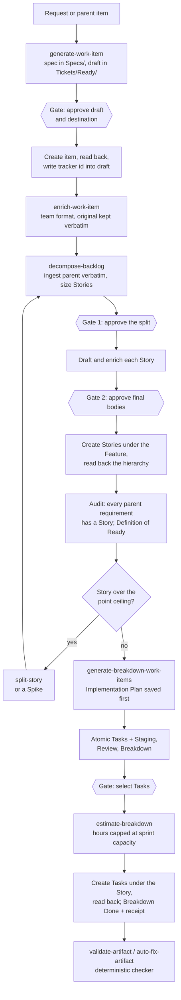
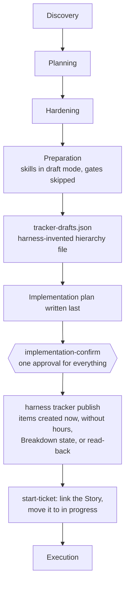
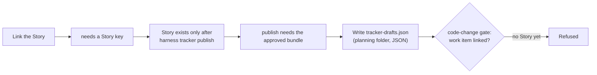
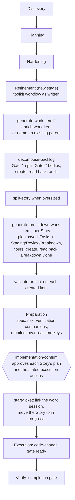
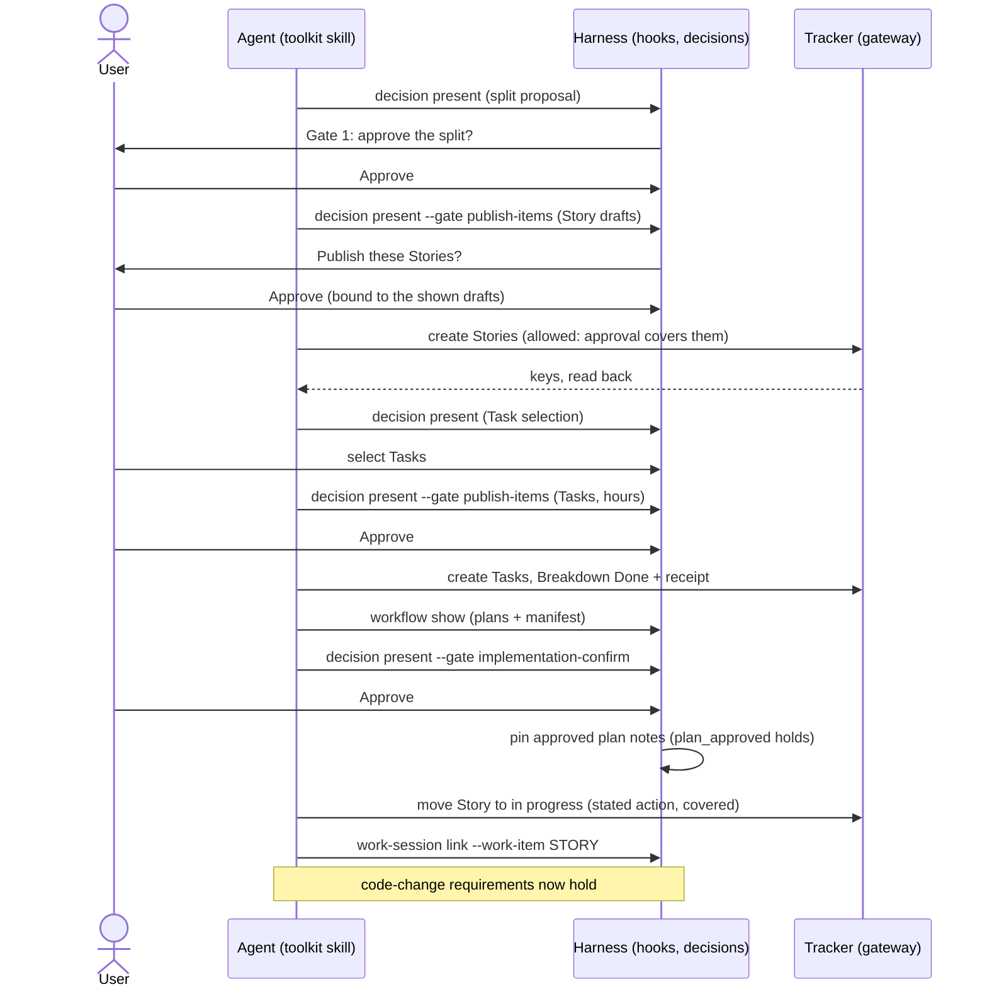
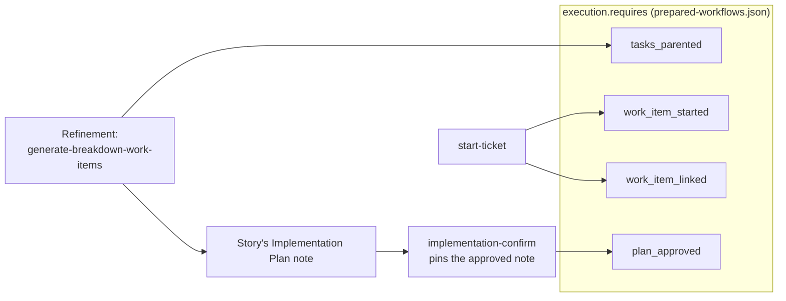

# Run the agile-backlog-toolkit workflow inside six-stage onboarding

> **Superseded in part.** The alignment document's decisions 6–12 replace this design's single
> `implementation-confirm` over all Story plans and its one Task batch across Stories: each Story's
> plan approval is its `implementation-confirm`, followed by its own Task approval. Where the two
> documents disagree, the alignment document wins.

## Problem

The harness ships the nine agile-backlog-toolkit skills (copied at `e7ae82c`), but not the workflow
they form. On the six-stage route, the default for feature work, three of them run in a harness
"draft mode" that skips their own phases and gates, writes a harness-invented
`tracker-drafts.json`, and leaves creation to `harness tracker publish` after the final approval.

That contradicts the owner's model: work items are created in the tracker first, by the toolkit's
own workflow, before the implementation plan and before code. It also caused the deadlock seen in
trial `20261015-day001-planning-gate-02`: the plan needs a linked Story, and the Story exists only
after the final approval.

### Evidence

| What | Where |
| --- | --- |
| Draft mode replaces each skill's phases and gates with `implementation-confirm` | `skills/generate-work-item/SKILL.md:10-17`, `skills/decompose-backlog/SKILL.md:10-19`, `skills/generate-breakdown-work-items/SKILL.md:9-15` |
| Preparation prepares only `generate-work-item` and `bmad-spec` for the agent | `config/prepared-workflows.json`, stage `preparation` |
| Publication writes description, acceptance criteria and estimate only; no hours, iteration, Breakdown state, read-back, or id write-back | `scripts/harness/bundle.py` `_create_all`, `_description` |
| Refinement check requires one Task per Story, not Staging/Review/Breakdown; no coverage audit or Definition of Ready | `scripts/harness/bundle.py` `check_drafts` |
| `tracker-drafts.json` in the planning folder counts as code when no source globs are set, so the code-change gate refuses it | `scripts/policy/commands.py` `is_code`; trial 02 parent report, finding 4 |

## Principles

1. The toolkit's workflow runs as written: its phases, its gates, its read-backs, its audit.
   The harness adds no parallel backlog mechanics.
2. Tracker first. Epics, Features, Stories and Tasks exist in the selected tracker (read back)
   before the implementation plan is approved and before any code changes.
3. Every tracker write goes through the harness gateway and its approval windows, so the toolkit's
   gates are presented with `harness decision present` and bound to the reviewed content.
4. Requirements stay in the workflow catalog. Code changes and completion keep reading
   `config/prepared-workflows.json`; nothing here depends on version control.

## The toolkit's workflow

## Today's six-stage route

### Where trial 02 stalled

## Proposed route

Preparation is split in two. **Refinement** runs the toolkit's workflow with its own gates and
creates the items. **Preparation** then writes the implementation plan against items that exist.

### Who approves what

### What the code-change gate reads, and where each item comes from

## Changes

| Area | Change |
| --- | --- |
| Catalog | New `refinement` stage after `hardening`, preparing `generate-work-item`, `enrich-work-item`, `decompose-backlog`, `split-story`, `generate-breakdown-work-items`, `validate-artifact`, `auto-fix-artifact`, `generate-plain-language-documentation`, with tracker operations. `preparation` keeps spec, risk and manifest. The `onboarding` route gains the stage. |
| Skills | Remove the three "Six-stage preparation mode" sections. Restore the toolkit's phases and gates, presented through `harness decision present` and bound by `publish-items`. Keep the harness tracker contract wording (gateway tools, not Azure calls). |
| Tracker drafts | Retire `tracker-drafts.json`, `bundle.load_drafts`/`check_drafts`/`publish`/`_create_all`, `harness tracker publish`, and `references/tracker-drafts.md`. |
| Confirmation | `implementation-confirm` binds the Stories' Implementation Plans, the manifest and companions. It requires every Story in scope to exist in the tracker with Tasks (the `tasks_parented` check per Story), not a drafts file. On approval, the hook pins the approved plan notes, which already satisfies `plan_approved`. `bundle.covers` and `tracker-published.json` go. |
| Gates | Add a `refinement-split` decision (kind `required`, no writes) for Gate 1. Reuse `publish-items` for Gate 2 and the Task batch. `implementation-confirm` wording drops "create work items". |
| Local tracker | The toolkit's `local` destination means the harness local tracker, written through the gateway. Readable drafts in `Tickets/Ready/` stay the review surface. |
| Docs | `six-stage-onboarding.md`, `workflow-storyboard.md`, `harness-stage-guide.md`, the harness skill, and the changelog. |
| Trial setup | Prepare hook trust and MCP tool approval in the isolated Codex home through a recorded, human-approved step (trial 02 findings 1 and 2). |

## Effect on approvals

| | Today | Proposed |
| --- | --- | --- |
| Split of the work | none | 1 decision (Gate 1) |
| Creating Stories | inside `implementation-confirm` | 1 `publish-items` |
| Creating Tasks | inside `implementation-confirm` | 1 `publish-items` (one batch across Stories) |
| Plan and execution | 1 `implementation-confirm` | 1 `implementation-confirm` |

Three more interactions per feature, in exchange for items that exist, are read back, and carry
hours and the Breakdown receipt before the plan is approved.

## Verification

- Unit tests: catalog stage and requirement wiring; confirmation refuses when a Story in scope has
  no Tasks in the tracker; the hook pins plan notes on `implementation-confirm`; removed commands
  and files are gone; the toolkit gates bind `publish-items` to the shown drafts.
- Retire or rewrite `tests/harness/test_bundle.py` and the bundle-order contract test.
- Live: rerun DAY-001 on a fresh fixture with hook trust and MCP approval prepared, through
  refinement, confirmation and `start-ticket`, then one attempted code edit before and after
  linking. Stop before implementation.

## Decisions (owner, 2026-10-15)

1. **Stories and Tasks are approved separately**, in the toolkit's order: one `publish-items` for
   the Stories, then one for the Tasks.
2. **No compatibility path.** Everything is still testing; there are no production sessions to
   carry. `tracker-drafts.json` and `harness tracker publish` are removed outright.
3. **One plan per User Story.** Each Story's Implementation Plan is its execution contract; there
   is no aggregate plan. `implementation-confirm` approves the Story plans in the batch.
4. **Enrichment follows the toolkit.** When the user supplies an already formatted User Story, a
   Feature with formatted Stories, or an Epic, refinement only checks the format
   (`validate-artifact`) and enriches what fails, as the agile-backlog-toolkit does; it does not
   re-enrich formatted items.
