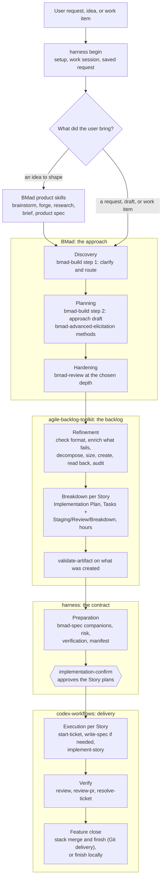
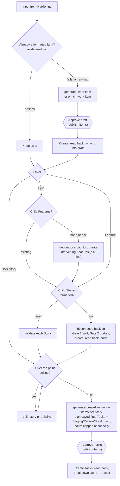
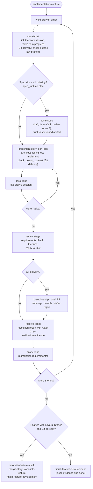
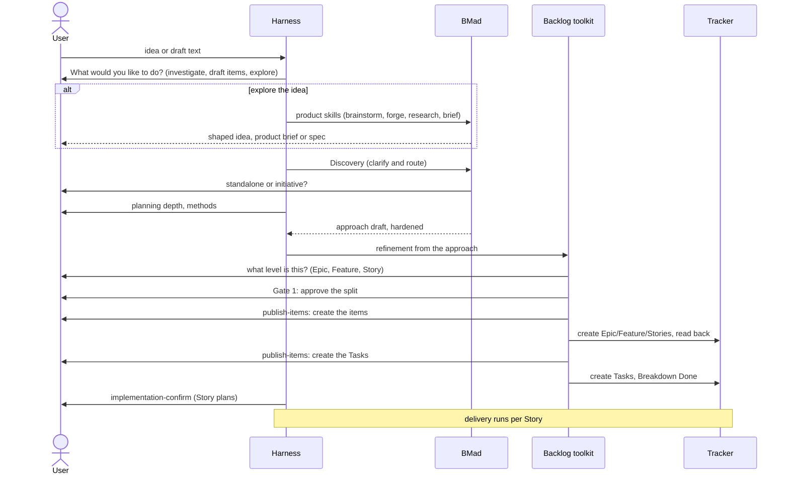
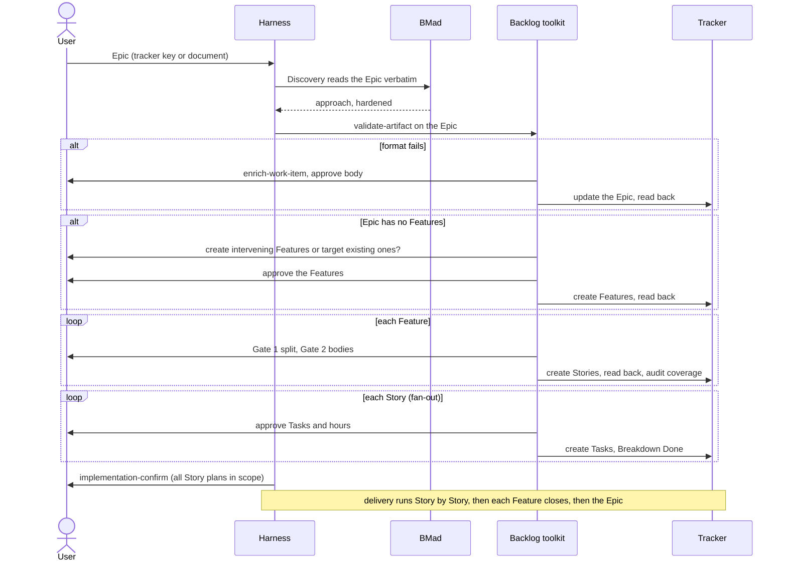
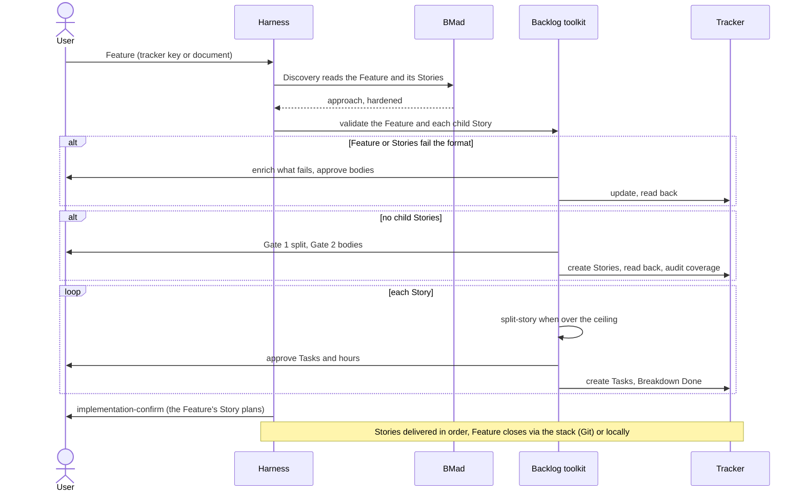
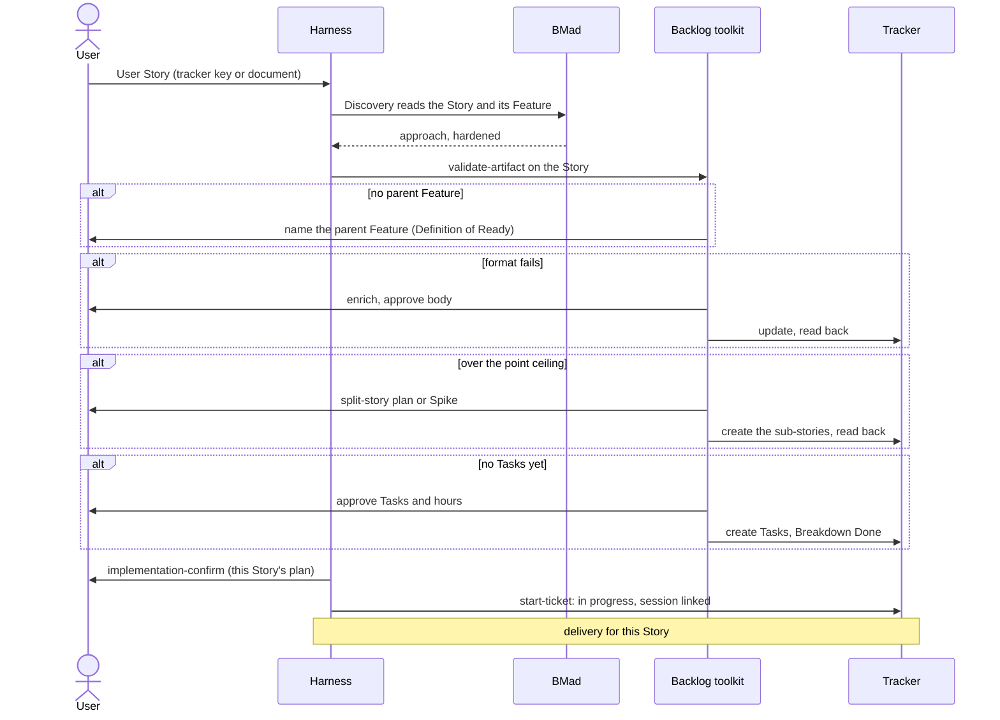

# Workflow alignment

The harness is assembled from three sources. Each one brings a workflow, not only skills:

| Source | Copied at | Brings | Owns |
| --- | --- | --- | --- |
| BMad Method | `1cbcfa2` | BMad Build discovery and planning, elicitation, review, product skills | Understanding and the approach |
| agile-backlog-toolkit | `e7ae82c` | Work-item creation, enrichment, decomposition, sizing, breakdown, validation | The backlog: Epics, Features, Stories, Tasks, one Implementation Plan per Story |
| codex-workflows-plugin | `75c22f0` | Tracked delivery: start, spec with critic review, PR review, resolution, Feature stacks | Delivery and its evidence |

Today the harness keeps the skills but drops much of the workflow that links them. This document
sets out how the three workflows run end to end inside the harness, and the sequences a user goes
through depending on what they start with. It is a working draft to refine into the alignment plan.

Companions: [backlog design detail](2026-10-15-backlog-workflow-in-six-stage-design.md) (today's
six-stage route, where trial 02 stalled, who approves what, and what the code-change gate reads).
Rendered diagrams: [this document](2026-10-15-workflow-alignment-diagrams/),
[the backlog design](2026-10-15-backlog-workflow-diagrams/).

## Principles

1. Each source's workflow runs as written: its phases, gates, read-backs, audits and critic reviews.
   The harness adds no parallel mechanics for what a source already owns.
2. Tracker first. Work items exist in the selected tracker, read back, before the Story plans are
   approved and before code changes.
3. Every tracker write goes through the harness gateway and its approval windows; every human
   decision goes through `harness decision present`.
4. What each stage needs and produces is declared in `config/prepared-workflows.json`. Nothing in the
   harness's own decisions depends on version control; Git-specific steps run only with Git delivery.

## The whole route

## Front half: BMad

| Stage | BMad skill | Produces |
| --- | --- | --- |
| Discovery | `bmad-build` step 1 (rendered by `harness begin` into `_bmad/render/`) | Clarified request, route, initiative choice, code map |
| Planning | `bmad-build` step 2, `bmad-advanced-elicitation` | The approach draft and its memlog; depth and method choices |
| Hardening | `bmad-review` | Triaged findings; consequential choices settled |
| Idea route | `brainstorm-ideas`, `forge-idea`, `research-decision`, `product-brief`, `product-spec`, `plan-initiative` | A shaped idea before technical discovery |
| Any stage, as needed | `bmad-correct-course`, `bmad-project-context`, `bmad-deep-recon`, `bmad-qa-generate-e2e-tests` | Change of direction, instruction drift, reconnaissance, end-to-end tests |
| Preparation | `bmad-spec` | Spec and companions for each Story |

BMad's approach draft is the input to refinement. It is carried as a reviewed companion, not
approved as a plan: the execution contract is each Story's Implementation Plan.

## Middle: the backlog (agile-backlog-toolkit)

## Back half: delivery (codex-workflows)

## Sequences by starting point

Every sequence starts with `harness begin`, which checks setup, routes the work session and saves
the exact request. The four starting points differ in what refinement has to do.

### 1. An idea or a free-text draft

### 2. An Epic

### 3. A Feature

### 4. A User Story

### Short path for a Story that is already refined

When the Story already has its Tasks in the tracker and an approved Implementation Plan, the
code-change requirements are met as soon as `start-ticket` links it. The `implement-approved-item`
route (setup → build → verify) then applies without repeating discovery and refinement. Whether
the full BMad front half should still run in that case is open question 1.

## Approvals per starting point

| Starting point | Split | Create items | Create Tasks | Story plans |
| --- | --- | --- | --- | --- |
| Idea or draft | Gate 1 per decomposed level | 1 `publish-items` per level | 1 `publish-items` | 1 `implementation-confirm` |
| Epic | Gate 1 per Feature | Features, then Stories | 1 `publish-items` across Stories | 1 `implementation-confirm` |
| Feature | Gate 1 when Stories are missing | Stories when missing | 1 `publish-items` across Stories | 1 `implementation-confirm` |
| User Story | split plan only when oversized | sub-stories only when split | 1 `publish-items` | 1 `implementation-confirm` |

Already formatted items are only validated; updates to existing items need their own approval.

## What changes in the harness

| Area | Change |
| --- | --- |
| Catalog | New `refinement` stage after `hardening` preparing the toolkit skills and tracker operations. `execution` prepares `start-ticket`, `write-spec`, `implement-story`; `verify` prepares the review stage, `review-pr` (Git delivery), `resolve-ticket`, and the Feature-close skills. Stack skills are prepared only with Git delivery. |
| Skills | Remove the three six-stage "draft mode" sections; restore the toolkit phases and gates through `harness decision present` and `publish-items`. |
| Removed | `tracker-drafts.json`, `bundle.load_drafts`/`check_drafts`/`publish`/`_create_all`, `harness tracker publish`, `references/tracker-drafts.md`, `bundle.covers` and `tracker-published.json`. |
| Confirmation | `implementation-confirm` binds the Story plans in scope, the manifest and companions; it requires each Story to exist with Tasks; on approval the hook pins the plan notes, which satisfies `plan_approved`. |
| Gates | Add `refinement-split` (required, no writes). Reuse `publish-items`. Reword `implementation-confirm`. |
| Local tracker | The toolkit's `local` destination is the harness local tracker, written through the gateway; readable drafts in `Tickets/Ready/` stay the review surface. |
| Docs | `six-stage-onboarding.md`, `workflow-storyboard.md`, `harness-stage-guide.md`, the harness skill, changelog. |
| Trial setup | Prepare hook trust and MCP tool approval for the isolated Codex home through a recorded, human-approved step. |

## Decisions (owner, 2026-10-15)

1. Stories and Tasks are approved separately, in the toolkit's order.
2. No compatibility path: everything is still testing. `tracker-drafts.json` and
   `harness tracker publish` are removed outright.
3. One plan per User Story; no aggregate plan.
4. Enrichment follows the toolkit: formatted Stories, Features with formatted Stories, and Epics
   are only checked (`validate-artifact`); only what fails is enriched.
5. The `codex_workflows` step lists and templates are not restored: the harness skills already
   carry the Feature-stack sequences, and the toolkit owns work-item templates. What returns is the
   catalog wiring for `review-pr`, `resolve-ticket` and the Feature-stack skills.

## Open questions

1. A Story that is already refined (Tasks and approved plan exist): run the BMad front half, or go
   straight to `implement-approved-item`?
2. Spec ownership: `write-spec` plans spec kinds per ticket (`spec_runtime`: for a feature,
   design-doc + tech-spec), while `bmad-spec` writes companions in preparation and the toolkit writes
   the Implementation Plan. Which one owns the technical spec, and should `write-spec` treat the
   approved plan and companions as already covering its kinds?
3. Work sessions for an Epic or a multi-Story Feature: one session that relinks Story by Story, or
   one session per Story?
4. Closing a Feature without Git delivery: `finish-feature-development` in a local mode (evidence
   and done), or leave the Feature open for a person?
5. The idea route: should it always continue into technical discovery, or may it stop at a product
   brief?
6. `implementation-confirm` across an Epic: one approval for every Story plan in the Epic, or one
   per Feature?

## Evidence

- Trial `20261015-day001-planning-gate-02` (parent report): hooks inactive until trusted, MCP tools
  blocked by Codex approval policy, the drafts-file deadlock, and BMad discovery and elicitation
  observed live.
- Source reads: agile-backlog-toolkit `/mnt/DATA/Projects/Personal/agile-backlog-toolkit` at
  `e7ae82c`; codex-workflows-plugin `/mnt/DATA/Projects/Personal/codex-workflows-plugin` at `75c22f0`.
