# Workflow alignment

The harness is assembled from three sources. Each one brings a workflow, not only skills:

| Source | Copied at | Brings | Owns |
| --- | --- | --- | --- |
| BMad Method | `1cbcfa2` | BMad Build discovery and planning, elicitation, review, product skills | Understanding and the approach |
| agile-backlog-toolkit | `e7ae82c` | Work-item creation, enrichment, decomposition, sizing, breakdown, validation | The backlog: Epics, Features, Stories, Tasks, one Implementation Plan per Story |
| codex-workflows-plugin | `75c22f0` | Tracked delivery: start, spec with critic review, PR review, resolution, Feature stacks | Delivery and its evidence |

Today the harness keeps the skills but drops much of the workflow that links them. This document
sets out how the three workflows run end to end inside the harness, and the sequences a user goes
through depending on what they start with. It is a working draft to refine into the alignment plan.

Rendered diagrams: [2026-10-15-workflow-alignment-diagrams/](2026-10-15-workflow-alignment-diagrams/).

## Problem: today's six-stage route

On the six-stage route, the default for feature work, three toolkit skills run in a harness "draft
mode" that skips their own phases and gates, writes a harness-invented `tracker-drafts.json`, and
leaves creation to `harness tracker publish` after the final approval. Work items should instead be
created in the tracker first, by the toolkit's own workflow, before the Story plans and before code.
The draft mode also caused the deadlock in trial `20261015-day001-planning-gate-02`: the plan needs
a linked Story, and the Story exists only after the final approval.

| What | Where (under `plugins/monolithic-dev-harness/`) |
| --- | --- |
| Draft mode replaces each skill's phases and gates with `implementation-confirm` | `skills/generate-work-item/SKILL.md`, `skills/decompose-backlog/SKILL.md`, `skills/generate-breakdown-work-items/SKILL.md`, section "Six-stage preparation mode" |
| Preparation prepares only `generate-work-item` and `bmad-spec` | `config/prepared-workflows.json`, stage `preparation` |
| Publication writes description, acceptance criteria and estimate only; no hours, iteration, Breakdown state, read-back, or id write-back | `scripts/harness/bundle.py` `_create_all`, `_description` |
| The refinement check requires one Task per Story, not Staging/Review/Breakdown; no coverage audit or Definition of Ready | `scripts/harness/bundle.py` `check_drafts` |
| `tracker-drafts.json` in the planning folder counts as code when no source globs are set, so the code-change gate refuses it | `scripts/policy/commands.py` `is_code`; trial 02 parent report, finding 4 |

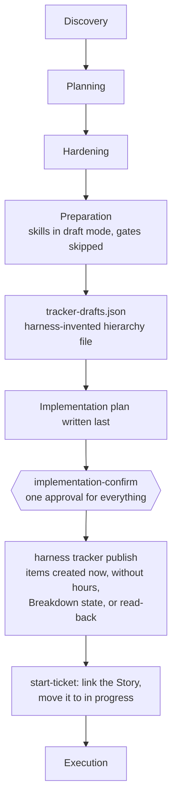

Where trial 02 stalled:

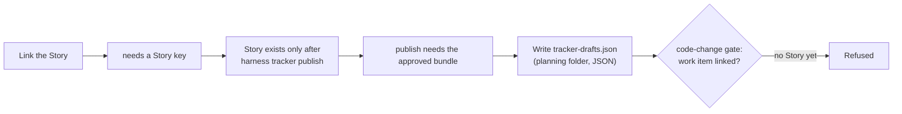

## Principles

1. Each source's workflow runs as written: its phases, gates, read-backs, audits and critic reviews.
   The harness adds no parallel mechanics for what a source already owns.
2. Tracker first. Work items exist in the selected tracker, read back, before the Story plans are
   approved and before code changes.
3. Every tracker write goes through the harness gateway and its approval windows; every human
   decision goes through `harness decision present`.
4. What each stage needs and produces is declared in `config/prepared-workflows.json`. Nothing in the
   harness's own decisions depends on version control; Git-specific steps run only with Git delivery.
5. Every document or work item that is created is shown to the user for approval, then saved through
   the selected tracker. There is no later approval that bundles several of them.
6. Work items are the source of truth. Plans, specs and Tasks are derived from them; a change of
   direction updates the work items first, then what derives from them.

## The whole route

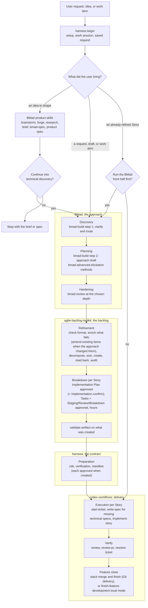

## Front half: BMad

| Stage | BMad skill | Produces |
| --- | --- | --- |
| Discovery | `bmad-build` step 1 (rendered by `harness begin` into `_bmad/render/`) | Clarified request, route, initiative choice, code map |
| Planning | `bmad-build` step 2, `bmad-advanced-elicitation` | The approach draft and its memlog; depth and method choices |
| Hardening | `bmad-review` | Triaged findings; consequential choices settled |
| Idea route | `brainstorm-ideas`, `forge-idea`, `research-decision`, `product-brief`, `bmad-spec`, `product-spec`, `plan-initiative` | A shaped idea and its product spec; the user then chooses to continue into technical discovery or stop |
| Any stage, as needed | `bmad-correct-course`, `bmad-project-context`, `bmad-deep-recon`, `bmad-qa-generate-e2e-tests` | Change of direction, instruction drift, reconnaissance, end-to-end tests |

BMad's approach draft is the input to refinement. It is carried as a reviewed companion, not
approved as a plan: the execution contract is each Story's Implementation Plan. `bmad-spec` writes
the product-level spec (why, capabilities, constraints, non-goals, success signal) on the idea route;
it no longer writes companions in preparation, where they overlapped with `write-spec`.

## Middle: the backlog (agile-backlog-toolkit)

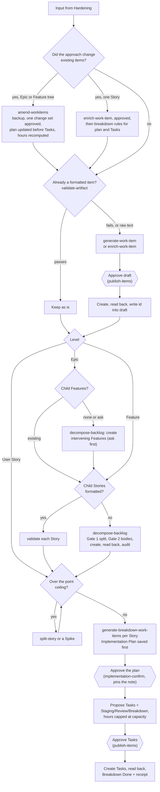

## Back half: delivery (codex-workflows)

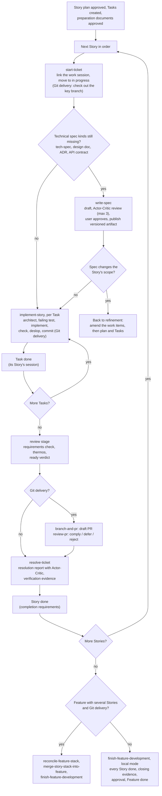

## Sequences by starting point

Every sequence starts with `harness begin`, which checks setup, routes the work session and saves
the exact request. The work session tracks the item the user starts with: an Epic, a Feature or a
Story (an idea or draft is tracked by the item refinement creates for it). The four starting points
differ in what refinement has to do.

### 1. An idea or a free-text draft

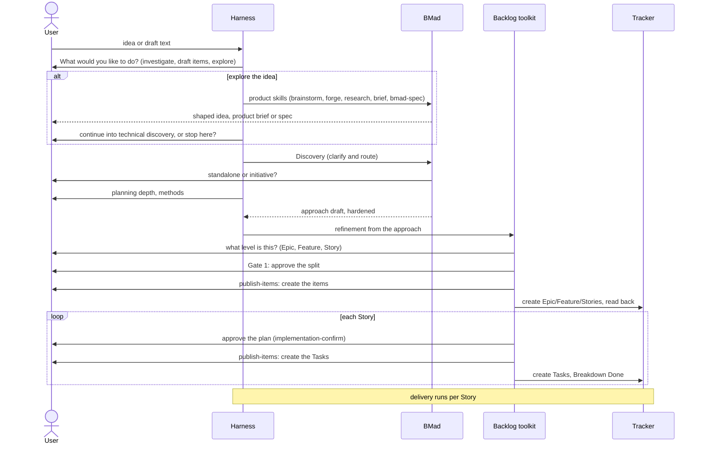

### 2. An Epic

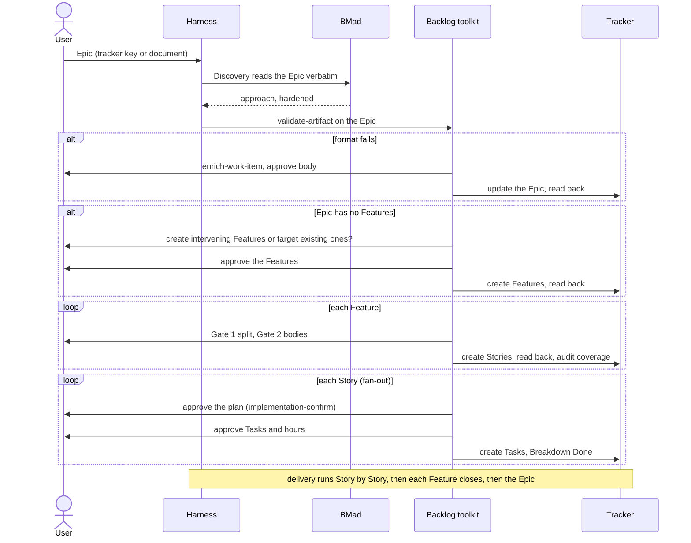

### 3. A Feature

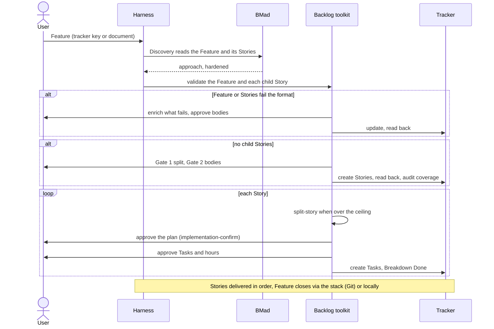

### 4. A User Story

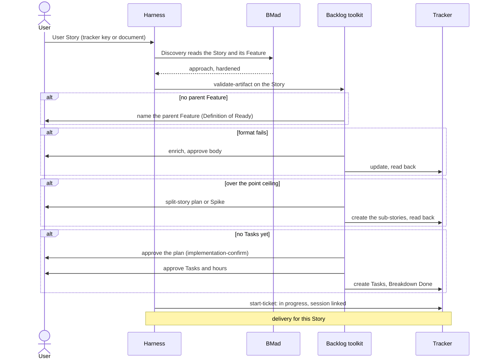

### A Story that is already refined

When the Story already has its Tasks in the tracker and an approved Implementation Plan, the harness
asks the user whether to run the BMad front half or go straight to delivery.

- **Straight to delivery:** `start-ticket` links it, which meets the code-change requirements, and
  the `implement-approved-item` route (setup → build → verify) runs.
- **Front half first:** if discovery, planning or hardening changes anything, the work items are
  updated first, as the toolkit does it: `amend-workitems` for an Epic or Feature tree (backup, one
  approved change set, the plan updated before its Tasks, hours recomputed), or `enrich-work-item`
  plus the breakdown rules for a single Story. The updated plan and Tasks are approved again.

## Approval mechanics for one Story

Each toolkit gate is presented with `harness decision present` and bound to the content shown, so a
tracker write is allowed only for what the user approved.

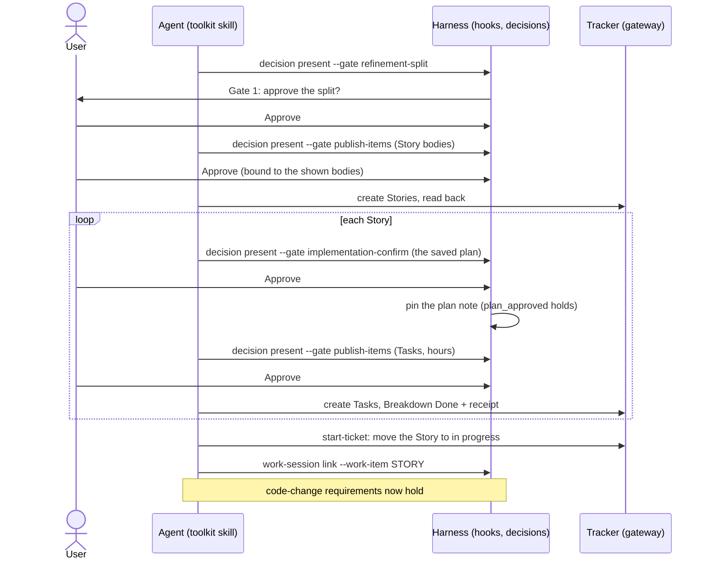

What the code-change gate reads (`execution.requires` in `config/prepared-workflows.json`) and where
each requirement comes from:

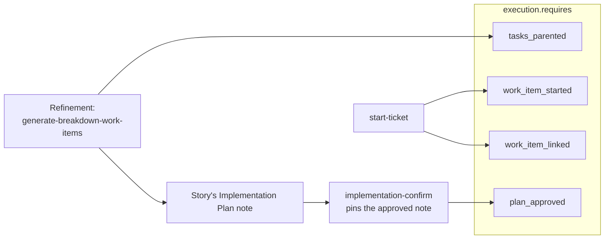

## Approvals per starting point

| Starting point | Split | Create items | Story plan | Create Tasks |
| --- | --- | --- | --- | --- |
| Idea or draft | Gate 1 per decomposed level | 1 `publish-items` per level | 1 `implementation-confirm` per Story | 1 `publish-items` per Story |
| Epic | Gate 1 per Feature | Features, then Stories | 1 `implementation-confirm` per Story | 1 `publish-items` per Story |
| Feature | Gate 1 when Stories are missing | Stories when missing | 1 `implementation-confirm` per Story | 1 `publish-items` per Story |
| User Story | split plan only when oversized | sub-stories only when split | 1 `implementation-confirm` | 1 `publish-items` |

Already formatted items are only validated; updates to existing items need their own approval.
Preparation documents and `write-spec` specs are each approved when created. Closing a Feature
locally takes one approval.

## What changes in the harness

| Area | Change |
| --- | --- |
| Catalog | New `refinement` stage after `hardening` preparing `generate-work-item`, `enrich-work-item`, `amend-workitems`, `decompose-backlog`, `split-story`, `generate-breakdown-work-items`, `validate-artifact`, `auto-fix-artifact` and `generate-plain-language-documentation`, with tracker operations; the `onboarding` route gains the stage. `preparation` keeps risk, verification and the manifest. `execution` prepares `start-ticket`, `write-spec`, `implement-story`; `verify` prepares the review stage, `review-pr` (Git delivery), `resolve-ticket`, and the Feature-close skills. Stack skills are prepared only with Git delivery. |
| Skills | Remove the three "Six-stage preparation mode" sections; restore the toolkit phases and gates through `harness decision present` and `publish-items`. Keep the harness tracker contract wording (gateway tools, not Azure calls). |
| Removed | `tracker-drafts.json`, `bundle.load_drafts`/`check_drafts`/`publish`/`_create_all`, `harness tracker publish`, `references/tracker-drafts.md`, `bundle.covers` and `tracker-published.json`. |
| Confirmation | `implementation-confirm` is the approval of one Story's Implementation Plan in breakdown (the toolkit's optional plan wait, made required). It requires the Story to exist in the tracker; on approval the hook pins the plan note, which satisfies `plan_approved`. No approval bundles several Stories. |
| Specs | `write-spec` owns technical specs (tech-spec, design doc, ADR, API contract) and drops its `implementation-plan` kind; it treats the approved plan as covering that kind and writes only missing kinds. `bmad-spec` leaves preparation. A spec that changes scope sends the work back to refinement. |
| Sessions | A work session tracks the entry item (Epic, Feature or Story); code baselines stay per work item. |
| Feature close | `finish-feature-development` gains a local mode: every child Story done, closing evidence recorded, one approval, Feature moved to done. |
| Idea route | Ends with a decision: continue into technical discovery, or stop with the brief or spec. |
| Refined Story | `harness begin` asks whether to run the BMad front half; changes to existing items go through `amend-workitems` or `enrich-work-item` before plan and Tasks. |
| Gates | Add `refinement-split` (required, no writes) for Gate 1. Reuse `publish-items` for Gate 2 and for each Story's Tasks. `implementation-confirm` wording drops "create work items" and names one Story's plan. |
| Local tracker | The toolkit's `local` destination is the harness local tracker, written through the gateway; readable drafts in `Tickets/Ready/` stay the review surface. |
| Docs | `six-stage-onboarding.md`, `workflow-storyboard.md`, `harness-stage-guide.md`, the harness skill, changelog. |
| Trial setup | Prepare hook trust and MCP tool approval for the isolated Codex home through a recorded, human-approved step. |

## Verification

- Unit tests: catalog stage and requirement wiring; `implementation-confirm` refuses a Story that is
  not in the tracker; the hook pins the plan note on approval; `publish-items` binds toolkit writes
  to the shown content; removed commands and files are gone; `write-spec` skips kinds the approved
  plan covers; `finish-feature-development` local mode refuses while a child Story is open.
- Retire or rewrite `tests/harness/test_bundle.py` and the bundle-order contract test.
- Live: rerun DAY-001 on a fresh fixture with hook trust and MCP approval prepared, through
  refinement, plan approval and `start-ticket`, with one code edit attempted before and after
  linking. Stop before implementation.

## Decisions (owner, 2026-10-15)

1. Stories and Tasks are approved separately, in the toolkit's order: one `publish-items` for the
   Stories, then, per Story, its plan and its Tasks.
2. No compatibility path: everything is still testing. `tracker-drafts.json` and
   `harness tracker publish` are removed outright.
3. One plan per User Story; no aggregate plan.
4. Enrichment follows the toolkit: formatted Stories, Features with formatted Stories, and Epics
   are only checked (`validate-artifact`); only what fails is enriched.
5. The `codex_workflows` step lists and templates are not restored: the harness skills already
   carry the Feature-stack sequences, and the toolkit owns work-item templates. What returns is the
   catalog wiring for `review-pr`, `resolve-ticket` and the Feature-stack skills.
6. Every created document or work item is shown for approval, then saved through the selected
   tracker. Work items are the source of truth; plans, specs and Tasks derive from them.
7. An already-refined Story: ask the user whether to run the BMad front half. If it changes anything,
   amend the work items first (`amend-workitems` for a tree, `enrich-work-item` for one Story), then
   the plan and Tasks, and approve them again.
8. Spec ownership: the toolkit's Implementation Plan is the Story's contract (every acceptance
   criterion mapped, Tasks derived from it). `write-spec` owns the technical specs with its critic
   review and drops its weaker `implementation-plan` kind. `bmad-spec` stays on the idea route.
9. A work session tracks whatever the user starts with: an Epic, a Feature or a Story.
10. A Feature closes without Git delivery through `finish-feature-development` in a local mode.
11. The idea route may stop at a product brief or spec; the user chooses whether to continue.
12. No aggregate confirmation: each Story's plan approval is its `implementation-confirm`, followed by
    its Task approval, as the toolkit's fan-out does it.

## Evidence

- Trial `20261015-day001-planning-gate-02` (parent report): hooks inactive until trusted, MCP tools
  blocked by Codex approval policy, the drafts-file deadlock, and BMad discovery and elicitation
  observed live.
- Source reads: agile-backlog-toolkit `/mnt/DATA/Projects/Personal/agile-backlog-toolkit` at
  `e7ae82c`; codex-workflows-plugin `/mnt/DATA/Projects/Personal/codex-workflows-plugin` at `75c22f0`.
