# Harness main flow

Discovery → Planning → Hardening → Refinement → Preparation → Execution → Verify, with an optional
idea route in front. The order is the route in
[`config/prepared-workflows.json`](../../../plugins/monolithic-dev-harness/config/prepared-workflows.json):
`harness next` gives the agent its next step from it, the guards read their requirements from it,
and the diagram above is drawn from it (`scripts/harness/route_diagram.py`; the repository check
fails when they differ). The settled rules behind it are in the
[constitution](../../../CONSTITUTION.md).

## User experience

Discovery investigates before asking. When the user starts from an Epic, Feature or Story whose
text is already refined, they choose to rework it or use it as it is. Once the work is understood,
choose Light, Standard or Hardcore planning depth before drafting. Comprehensive paths offer a
contextual shortlist, full method catalog or agent recommendations. Retain Reshuffle, List all and
Proceed. Hardening validates the resulting approach; it is distinct from exploring approaches
before drafting.

Refinement runs the agile-backlog-toolkit skills against the selected tracker: each work item is
written in its type's template and approved before it is created; each Story's implementation plan
is shown and approved on its own, then its Tasks. Preparation writes the risk and verification
documents, each approved, and the reading manifest. Execution and Verify run Story by Story; a
Feature closes once all its Stories are done. Nothing is approved in bulk, and already accepted
decisions are recapped, not approved again. Merging and unrelated external writes remain
context-bound actions.

## Runtime boundaries

Native controls are first, followed by async native and faithful chat fallback. Failed delivery
is not an answer. Active-mode stop enforcement requires a staged decision rather than an untracked
prose menu. Suspension disables that enforcement and every other harness veto; observation may
retain genuine replies but cannot authorize an unreviewed action.

Language defaults to English if no preference is recorded. Free mode requires no session.
Progress can be saved while paused or waiting for an answer. Pause, resume, reset, restart and
drop preserve existing evidence. Changed circumstances trigger consultation, not blanket approval
expiry. Versioning is detected automatically at execution entry and is optional.

## BMAD alignment

Adopt evidence-first investigation and Code Maps, contextual elicitation, stakes-calibrated
reviewers, input reconciliation, coherence/preservation checks, lean specifications and companions.
The unified lifecycle, depth profiles, reading manifest and reliable native transport are harness
responsibilities. Do not copy upstream's pre-planning VCS gate or make every improvement blocking.

## Verification limits

The acceptance trial captured two blocking replies and one async reply, then continued with checks
suspended before quota interrupted it. Those observations prove those exchanges, not the entire
new workflow. A fresh live trial is required after regression verification; do not overwrite the
concurrent acceptance report or replace genuine host evidence with simulated approvals.
